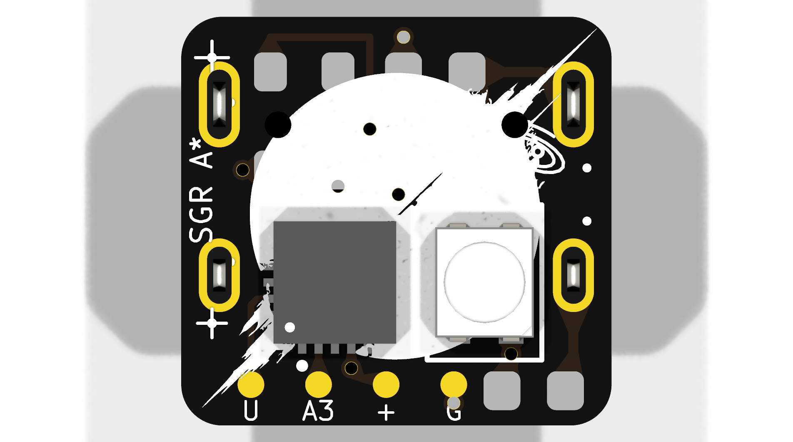
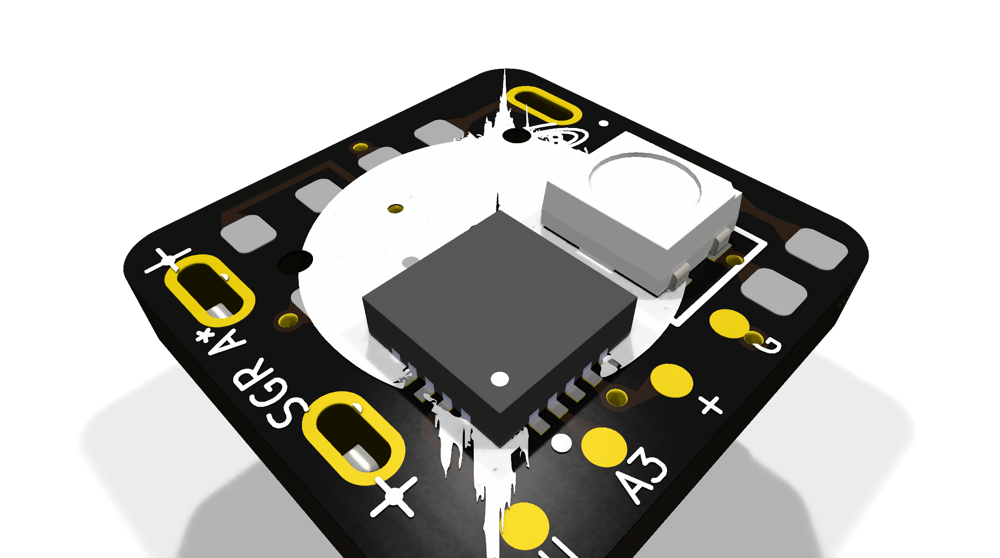
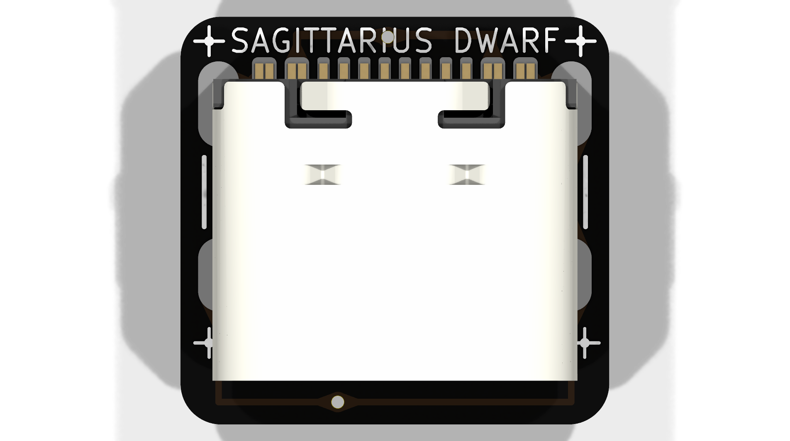

# Sagittarius Dwarf

The VERY tiny USB C microcontroller dev board themed after the Sagittarius Dwarf Spheroidal Galaxy and the supermassive black hole Sagittarius A\* (Sgr A\*).

---
## 3D Renders (Black Hole & Space Edition)

|          Top View           |             Isometric View              |            Bottom View            |
| :-------------------------: | :-------------------------------------: | :-------------------------------: |
|  |  |  |

---

## Features
- **Very Compact Footprint:** Only 10.5mm x 10mm, barely larger than the USB C plug.

- **Microchip ATtiny1616:**
	1. 8 bit RISC microcontroller going up to 20 MHz.
	2. 16 KB Flash, annd 2 KB SRAM.

- **Addressable RGB LED:**
	1. Featuring a WS2812B RGB LED connected directly to microcontroller.

- **USB Type C Connectivity:**
	1. 16 pin USB C receptacle.

- **Exposed GPIO & Programming Test Pads:**
	- Four test points arranged along the bottom edge:
	    1. **`U`**: Single wire `UPDI` programming & debugging interface (Pin 19).
	    2. **`A3`**: GPIO pin **`PA3`** (Pin 2).
	    3. **`+`**: **`+5V`** power.
	    4. **`G`**: **`GND`** ground.